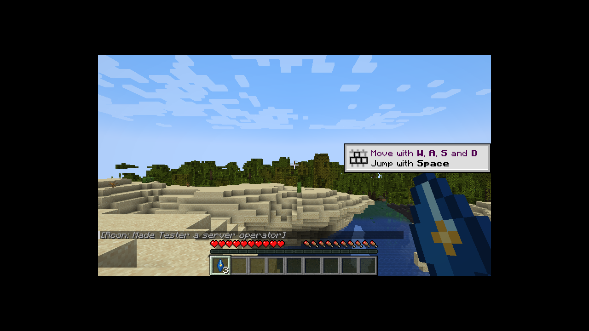

# Grand Line

A multiplayer RPG mod for **Minecraft Java Edition 1.20.1** on **Fabric**, inspired by the progression,
exploration, combat and fruit-ability loops of action RPGs like Blox Fruits. All content is original.

> **Status: Milestone 1 (foundation).** The project builds, loads on client and dedicated server, registers a
> test item, stores a persistent per-player profile, and has a validated networking layer. There is no fruit,
> combat or world-generation gameplay yet — see [ROADMAP.md](ROADMAP.md).

| | |
|---|---|
| Mod ID | `grandline` |
| Base package | `com.grandline` |
| Minecraft | 1.20.1 |
| Fabric Loader | 0.20.1 |
| Fabric API | 0.92.12+1.20.1 (latest for 1.20.1) |
| Mappings | Mojang official (`loom.officialMojangMappings()`) |
| Fabric Loom | 1.19.4 (`net.fabricmc.fabric-loom-remap`) |
| Gradle | 9.9.1 (wrapper) |
| Java | **17** bytecode for players; **JDK 25** needed to *build* (Loom 1.19 requires it) |

Versions were checked against `meta.fabricmc.net` and `maven.fabricmc.net` on 2026-11-12.



## Requirements

- **To build:** JDK 25 — Fabric Loom 1.19 refuses to run on older JVMs. Set `JAVA_HOME` to a JDK 25 install
  (e.g. [Eclipse Temurin](https://adoptium.net/)). The compiled mod targets Java 17.
- **To play:** Minecraft 1.20.1 with Fabric Loader ≥ 0.20.1, Fabric API for 1.20.1, Java 17 or newer.
- Internet access to `maven.fabricmc.net`, `meta.fabricmc.net`, Mojang's
  `piston-meta`/`piston-data`/`libraries.minecraft.net`/`resources.download.minecraft.net`, Maven Central
  and `services.gradle.org` (first build only; everything is cached afterwards).
- No local Gradle install needed — use the wrapper.

## Build

```bash
export JAVA_HOME=/path/to/jdk-25
./gradlew build
```

`build` compiles everything, runs the JUnit unit tests **and** the headless server game tests.

The release jar is written to:

```
build/libs/grandline-0.1.0.jar          # the mod — put this in a server's or client's mods/ folder
build/libs/grandline-0.1.0-sources.jar  # sources
```

Install it alongside **Fabric API 0.92.12+1.20.1** (or newer for 1.20.1) on Fabric Loader ≥ 0.20.1.
The mod is required on **both** client and server (it adds an item and custom packets).

## Run in development

| Command | What it does |
|---|---|
| `./gradlew runClient` | Launches the Minecraft client with the mod (run dir: `run/`) |
| `./gradlew runServer` | Launches a dedicated server with the mod (run dir: `run-server/`, so client and server can run together). Accept the EULA in `run-server/eula.txt` on first run. |
| `./gradlew test` | JUnit unit tests (progression maths, codecs) |
| `./gradlew runGameTest` | Headless server game tests; report at `build/reports/gametest/server-gametests.xml` |

IDE: open the folder in IntelliJ IDEA and set the Gradle JVM to JDK 25.

To test multiplayer locally: start `./gradlew runServer`, then
`./gradlew runClient --args="--quickPlayMultiplayer localhost:25565 --username Tester"` (set `online-mode=false`
in `run-server/server.properties` for offline dev accounts).

## Manual test checklist (in game)

1. `./gradlew runClient`, create a creative world with cheats on.
2. Open the **Grand Line** creative tab — the *Grand Line Crystal* should be there with its texture.
   Or: `/give @s grandline:grand_line_crystal`.
3. `/grandline test` — prints the mod version, server type, and `Grand Line Crystal registered: yes`.
4. `/grandline profile` — shows level 1, 0 XP, 0 currency, 0 stat points.
5. `/grandline admin addxp @s 260` → `/grandline profile` shows level 3, 10 XP, 6 stat points.
6. `/grandline admin addcurrency @s 500`, `/grandline admin setlevel @s 10`, `/grandline admin reset @s`.
7. `/grandlineclient profile` — the **client-side** synced copy; it should match the server's values.
8. Save & quit, re-open the world → profile is unchanged. Die and respawn → profile is unchanged.

### Commands

| Command | Permission |
|---|---|
| `/grandline test` | everyone |
| `/grandline profile` | everyone (own profile) |
| `/grandline profile <player>` | op level 2 |
| `/grandline admin addxp <players> <amount>` | op level 2 |
| `/grandline admin addcurrency <players> <amount>` (negative removes) | op level 2 |
| `/grandline admin setlevel <players> <level>` | op level 2 |
| `/grandline admin reset <players>` | op level 2 |
| `/grandlineclient profile` (client-side command) | everyone |

## Configuration

`config/grandline.json` is created on first start (server side). Values are validated and clamped on load;
a malformed file is renamed to `grandline.json.broken` and replaced with defaults.

| Key | Default | Meaning |
|---|---|---|
| `maxLevel` | 2800 | Level cap |
| `statPointsPerLevel` | 3 | Unallocated stat points granted per level |
| `baseExperiencePerLevel` | 100 | XP from level 1 → 2 |
| `experienceGrowthPerLevel` | 50 | Extra XP required per level beyond the first |
| `startingCurrency` | 0 | Currency for new profiles |
| `maxCurrency` | 1 000 000 000 000 | Currency cap |
| `requestCooldownTicks` | 4 | Minimum ticks between accepted client requests of one type |

## Documentation

- [ARCHITECTURE.md](ARCHITECTURE.md) — packages, data flow, networking & persistence design
- [ROADMAP.md](ROADMAP.md) — milestones
- [DEVELOPMENT_LOG.md](DEVELOPMENT_LOG.md) — what was done, verified and left open
