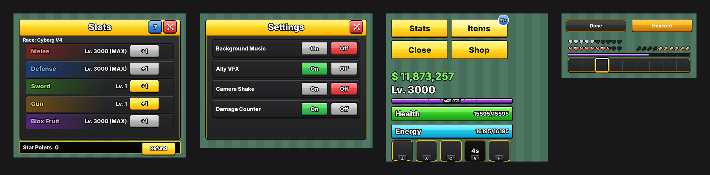

# Marsh UI resource pack

A Blox Fruits-style HUD and menu pack for Minecraft **1.20.1** (Forge/Fabric, `pack_format` 15).
It keeps the yellow-header, dark-body look of Blox Fruits and adds glossier, livelier detail.



## Install
Copy `dist/MarshUI.zip` into `.minecraft/resourcepacks/` and enable it.
Or bundle `pack/assets/...` inside your mod's resources.

## Build
```bash
python3 tools/build_pack.py          # writes pack/ and dist/MarshUI.zip
python3 tools/preview.py             # writes preview/*.png mockups
MODID=yourmodid python3 tools/build_pack.py   # put mod textures under your mod id
```
All colours are in the `PALETTE` block at the top of `tools/build_pack.py`.

## Vanilla textures replaced
| File | What |
|---|---|
| `gui/widgets.png` | hotbar, selected slot, offhand, buttons (dark + gold rim, amber on hover, so the white vanilla text stays readable) |
| `gui/icons.png` | hearts (all variants + hardcore), armor, hunger, air, purple XP bar, jump bar |
| `gui/slider.png`, `gui/checkbox.png` | settings controls |
| `gui/options_background.png`, `light_dirt_background.png` | charcoal swirl menu background (replaces dirt) |

## Mod textures (`assets/<modid>/textures/gui/`)
Your mod's HUD and screens draw these with `GuiGraphics.blit(texture, x, y, u, v, w, h)`.
Coordinates are `u, v, w×h`.

**`hud_bars.png`** (256×128)
- Big bar background: `0,0 180×22`
- Health fill: `0,24 180×22`. Blit the fill with `w = 180 * hp / maxHp`.
- Energy fill: `0,48 180×22`
- Level bar background / fill (purple, ticks): `0,72` and `0,80`, both `180×8`
- Small yellow bar background / fill: `0,92` and `0,100`, both `180×8`

**`hud_buttons.png`** (Stats / Items / Close / Shop)
- Buttons `84×28`: normal `0,0`, hovered `0,32`, pressed `0,64`
- Blue notification bubble: `96,0 16×16`

**`hud_abilities.png`** (Z X C V F skill slots, `32×32`, slot *k* at `u = k*34`)
- Ready: `v=0`
- Selected (gold): `v=34`
- Cooldown overlay: `v=68`
- Key tag `14×10`: `u = k*34+9, v=104`

**`window.png`**
- Menu window `0,0 240×180`: yellow title bar 24px tall, charcoal body, gold rim
- Footer strip: `0,186 240×18`

**`buttons.png`** (`60×20`; columns `u=0` normal, `64` hovered, `128` pressed)
- Rows: `v=0` yellow (+1 / Redeem / Refund), `24` grey (maxed / unselected), `48` green **On**, `72` red **Off**, `96` blue, `120` dark tab
- Close ✕ `20×20`: `0,144` normal, `24,144` hovered
- Blue `?` square: `48,144`
- To make a button wider, draw the outer 4px from each end and stretch the middle.

**`rows.png`** (list rows `220×28`, row *k* at `v = k*30`)
- `0` plain (Settings)
- `1` Melee (red), `2` Defense (blue), `3` Sword (green), `4` Gun (gold), `5` Blox Fruit (purple)

**`item_frame.png`**
- Gold item card: `0,0 40×40`
- Red "Permanent" tag: `44,0 50×12`
- Rarity glows `20×20` at `v=44`, `u = k*22`: common, uncommon, rare, legendary, mythical

Text such as titles, "Health" and numbers is drawn by your mod. For the Blox Fruits look, draw white text with a black outline (draw it offset by ±1 in black first). Use dark text on yellow buttons.

## If your mod uses different file names
Rename the files under `pack/assets/<modid>/textures/gui/` to match the paths your mod loads, or change the `save(...)` paths in `build_mod()`.
