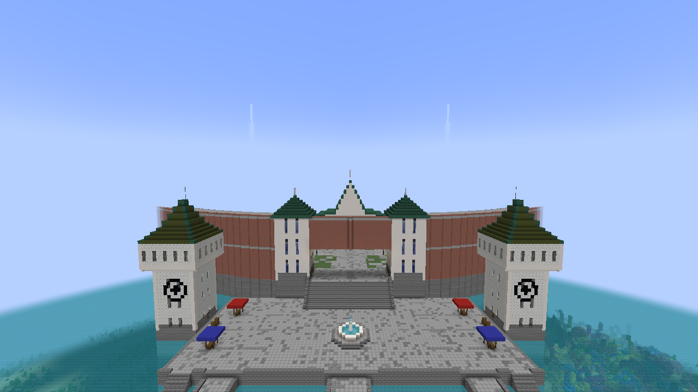
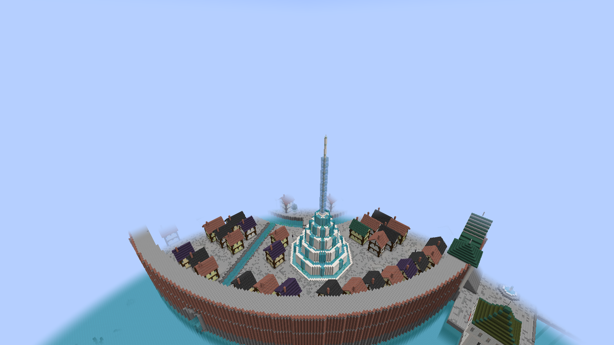

# Crystal Fountain (0.47.0, layout 14)

The owner's circular ocean city, built from their specification with three pieces of my own design (agreed in advance),
following the approved blueprint (docs/CRYSTAL_FOUNTAIN_BLUEPRINT.md). Code: `world/plan/CrystalFountain.java`.

## What is built

- **Concentric city:**
  - the landmark and its courtyard (y 76);
  - the red-brick enclosure (20 high, a pale band, gates east, west and north, the tall water passage south);
  - ring road A, the inner district (y 74), the main canal, ring road B, the middle district with the four fountain
    plazas, ring road C, and the outer district (y 72);
  - the outer red-brick wall (24 high, 10 thick, a pale band, a stone cap), standing in the sea.
- **Streets and water:**
  - eight radial streets (the harbour avenue 14 wide, with the water channel down its middle), with darker markings in
    a regular pattern on every road;
  - bridges over the canal and outlets;
  - three canal outlets through round arches in the wall, falling into the sea.
- **Townhouses:** 132 of them, each turned to face its street. Two to four floors, walls of white concrete, calcite,
  smooth sandstone or end stone bricks, dark oak frames, light blue windows, spruce doors, stairs between floors, beds,
  tables and lanterns. Red, green, blue and grey roofs (some mansard), chimneys, round attic windows. Five small
  gardens with compact trees and benches in the inner district.
- **Harbour:**
  - the 30-wide staircase from the gate down to the 90 x 35 arrival plaza (darker markings, a raised centre piece with
    a small crystal fountain, market stalls and barrels, side stairs to boat landings);
  - three piers (10 x 55 and 8 x 48) with hoists (posts, beam, chain, barrel);
  - the twin harbour towers (calcite shafts, wider chambers on corbels, iron-bar windows, steep green roofs, a dark
    emblem facing the sea).
- **Gateway:** two 13 x 13 white towers (three levels, tall blue windows, green pyramid roofs, banners, ladders) joined
  by a white bridge over the open passage (narrow pointed windows, a round blue window, a tall pointed centre roof and
  two sloping wings, lanterns under it).
- **Scrapyard (east):**
  - irregular dark ground in broad regions with rust patches;
  - a ramp from the east gate;
  - four lattice cranes (36-58 high, arms 30-50, cabs with gears, counterweights, chains, hanging iron platforms with
    timber);
  - gears standing, lying and half-buried, hollow pipes (broken and partly buried), red, blue and green cables, scrap
    heaps.
- **My own designs (agreed):**
  - a stepped octagonal landmark: buttressed base, lancet windows, shaft, crystal lantern room, faceted blue spire to
    y 201;
  - four stepped octagonal cascade fountains, about 90 high: five terraced pools, water over every face, a crystal
    obelisk on top;
  - the foundry engine: plinth, brick and iron boiler house, glowing blast furnaces, boiler drum, three smokestacks, a
    flywheel, copper pipes.

## Gameplay

- **Arrival:** the harbour plaza.
- **Fisherman and dock:** the central pier.
- **Quest giver:** just inside the gate.
- **Camps:** the north middle district (Raiders, Lv ~630-655 seen) and the scrapyard (Lv ~655-670 seen).
- **Boss:** the scrapyard yard by the engine.
- **Treasure:** legendary by the foundry engine, rare in the landmark's courtyard, commons on the north-west fountain
  plaza and the harbour plaza.

## Notes

- `minecraft:quartz_wall` does not exist in 1.20.1, so the finials use diorite walls.
- Waterfalls are real falling water, contained, as agreed.
- Existing worlds (layout 13 and older) keep the original Crystal Fountain and its chests.

## Checked

On a fresh world:
- The floating-block audit found no problems in the build. Its only findings were vanilla mushrooms that worldgen
  drops in dark spots; the automatic tidy removes them.
- All four chests are placed.
- The quest giver is in place, and both camps fill.
- Looked over in game: the harbour front, the city from above, a district, a fountain, the landmark's top, and the
  scrapyard and engine.

125 of 125 tests pass.
