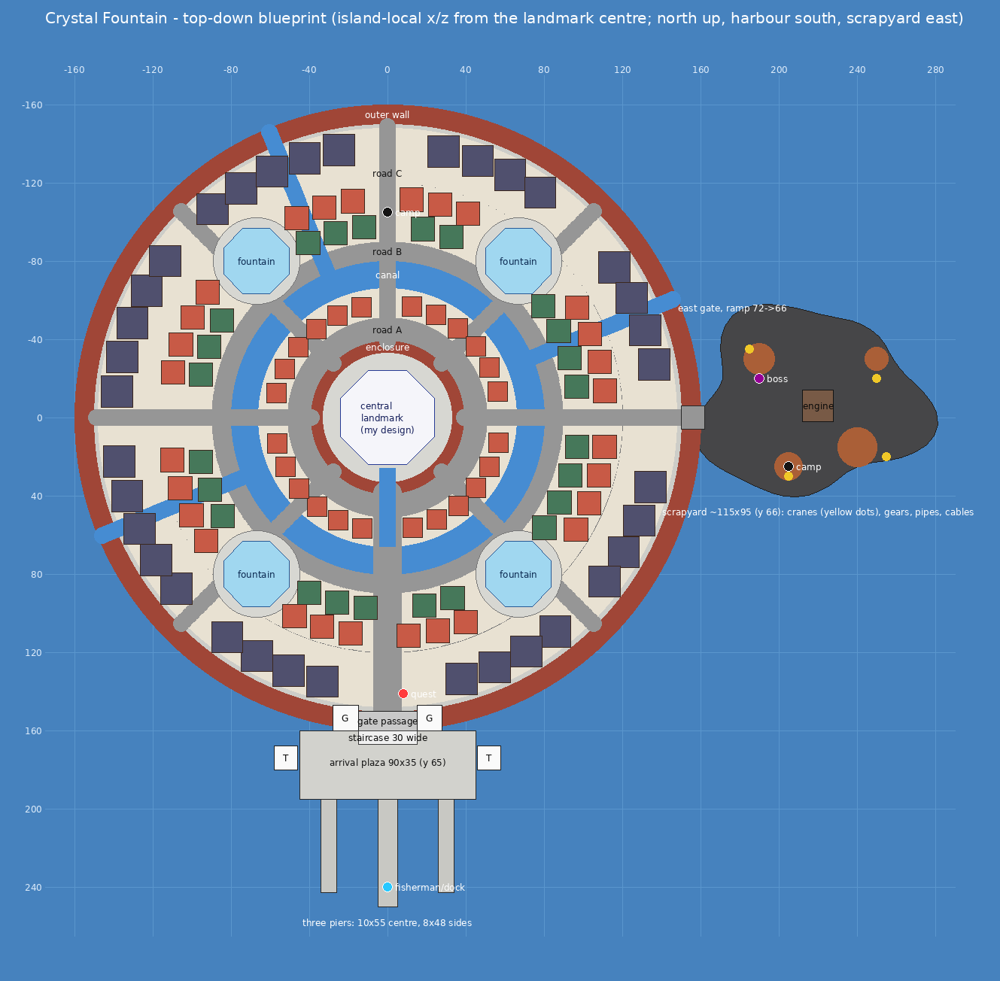
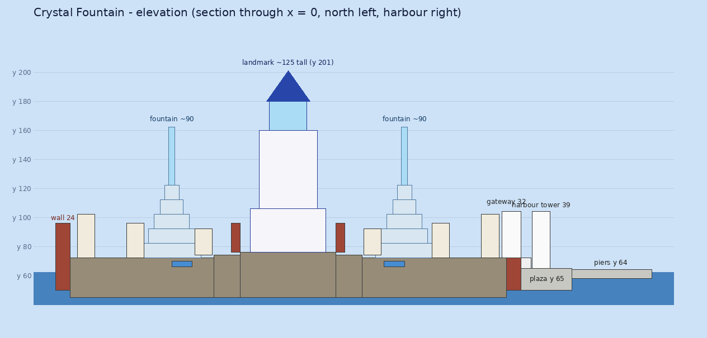

# Crystal Fountain: Phase 1 plan and blueprint (for approval)

Status: **proposed, waiting for the owner's approval.** Nothing is built yet.

## Repository findings (Phase 1)

* Today Crystal Fountain is `FirstSeaPlans.CrystalFountain`: a small quartz temple with crystal spikes, a pier, a quest
  giver, a fisherman, a dock, two camps, a boss spot and four treasure chests. Position (1200, 660), Lv 625-700.
* Rebuilds work like the other islands: a new plan class (`world/plan/CrystalFountain.java`) written as deterministic
  Java placement through the chunk-clipped `Canvas` (no .nbt templates are needed; the project uses none). The old plan
  is kept for older worlds through `IslandPlans.REDESIGNED_IN` at a new layout (14). Gameplay reads the plan's anchors,
  so quests, the quest compass, spawns, the boss, respawn and island detection follow automatically.
* Space: the city with its harbour and scrapyard reaches about 285 blocks from the centre. The nearest neighbours are
  Sunscorch Dunes (about 640 away, reach 88) and Ironhold Bastion (about 680 away, reach ~90), so nothing overlaps.

## Layout (island-local; landmark centre = 0, 0; north up, harbour south)

| Ring / piece | Radius or box | Ground y |
|---|---|---|
| Central landmark (**my design**) | octagon 52 across | 76 |
| Courtyard | r 26-33 | 76 |
| Enclosure wall (bricks, stone band, water passage south) | r 33-39, 20 high, 6 thick | 76-96 |
| Ring road A (main, 12 wide) | r 39-51 | 74 |
| Inner district (small and medium townhouses, green and red roofs) | r 51-66 | 74 |
| Main canal (water 10 wide, stone edges 2) | r 66-80 | water 70 |
| Ring road B (10 wide) | r 80-90 | 72 |
| Middle district (medium townhouses, two rows, the fountain plazas) | r 90-120 | 72 |
| Ring road C (10 wide) | r 120-130 | 72 |
| Outer district (large, taller townhouses) | r 130-148 | 72 |
| Outer wall (bricks, stone band, canal arches) | r 150-160, 24 high, 10 thick | 72-96 (footing in the sea) |
| Radial streets | 8, every 45 degrees; the harbour avenue 14 wide, the others 8, lanes 4-6 between | |
| Canal outlets to the sea (8 wide, arches in the wall, waterfalls) | NE, SW, NW | |
| Bridges | every street over the canal | |
| Fountains (**my design**) | plazas 44 across centred (+-67, +-80), r ~104 | 72 |
| Gateway towers | x -28..-15 and 15..28, z 147..160, 13 x 13, 32 high | |
| Gate passage + bridge | x -15..15 through the wall | 72 |
| Staircase | 30 wide, z 160..167, y 65 to 72 | |
| Arrival plaza | x -45..45, z 160..195 (90 x 35) | 65 |
| Harbour towers | x -58..-46 and 46..58, z 168..180, 12 x 12 shaft, 16 x 16 top, 39 high | 65 |
| Piers | centre x -5..4, z 195..250 (10 x 55); sides x -34..-27 and 27..34, z 195..243 (8 x 48); hoists at the ends | 64 |
| East gate and ramp | angle 0, y 72 down to 66 | |
| Scrapyard | irregular, x 158..273, z -55..40 (115 x 95) | 66 |
| Scrapyard centrepiece (**my design**) | ~16 x 16 at (220, -6) | 66-94 |

About 110 townhouses: roughly 22 in the inner ring, 45 in the middle, 45 in the outer. Each is turned (in 90-degree
steps) to face its nearest street, and grouped into clusters with lanes between them.

## The three pieces built to my own design (agreed)

1. **Central landmark:** a stepped octagonal spire, not a cylinder:
   - a 52-wide octagonal base about 30 high with flying buttresses at its corners;
   - an octagonal shaft narrowing to about 40 wide, up to about y 160;
   - a crystal lantern room (light blue and cyan glass, sea lanterns);
   - a faceted blue spire to about y 201 (125 above the courtyard).
   - Built in white quartz and calcite with blue glass, with tall lancet windows outlined in blackstone. There is no
     flared balcony and no rounded dome.
2. **Fountains:** four stepped octagonal cascades:
   - five terraced pools of quartz, each smaller and higher, about 40 wide at the base;
   - water spilling over every terrace edge in broad curtains;
   - a crystal obelisk with sea lanterns on top, about 90 tall;
   - runoff channels to the main canal. They are not a stack of bowls on columns.
3. **Scrapyard centrepiece:** a great foundry engine:
   - a riveted iron, deepslate and brick boiler house with three smokestacks;
   - a big flywheel gear on its side;
   - copper pipes, about 28 high.

## Where the spec's numbers needed a choice (please confirm)

1. **Harbour length:** the spec says the harbour extends 75 blocks, but the 35-deep plaza plus 55-long piers is 90.
   I keep both sizes, so the harbour reaches 90 past the wall.
2. **Elevations** are not in the spec. I chose: sea 62, piers 64, plaza 65, city 72, inner district 74, courtyard 76;
   the 30-wide staircase climbs from the plaza to the gate.
3. **Rings:** the spec's district diameters and road and canal widths don't all fit together. I used one main canal
   (between the inner and middle districts) and radial secondary canals to the sea instead of a second ring canal, so
   the outer district stays deep enough for the large townhouses.
4. **Fountain plazas** sit across ring roads B and C, which run round the plaza edges.
5. **Waterfalls:** real falling water, contained like the Mistfall waterfall, rather than a custom animated surface.
   Foam and splash particles can be a later addition.
6. **Treasure chests:** the spec says none, so the new layout has none (like Frostpeak). Older worlds keep the current
   island's four chests.
7. **Townhouse heights:** 2, 3 and 4 floors of 5 blocks plus steep roofs give 16-20, 22-27 and 28-35, matching the spec.

## Gameplay (existing systems, new spots)

* Arrival: the harbour plaza.
* Fisherman: on the central pier. Dock: at the central pier's end.
* Quest giver: just inside the gate (8, 73, 141).
* Camps: the north middle district (0, -105), and the scrapyard (205, 25).
* Boss: the scrapyard yard by the foundry engine (190, -20).
* Existing worlds keep their island and NPCs (layout versioning).

## Estimate

About 3-4 hours of work once approved: city foundation, rings and walls; landmark and fountains; harbour and gateway;
streets and about 110 houses; scrapyard; then gameplay, audit, in-game checks and tests.
