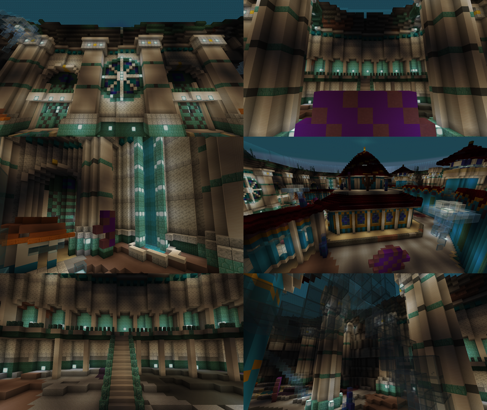

# Lotus Palace — cavern overhaul (layout 18)

Code: `world/plan/LotusCavern.java` (called from `LotusPalace`). The palace, towers, roofs, wave arches, houses,
whirlpools, NPC anchors, camps and chests are unchanged; this redesigns the cavern round them.

## Walls (written in the late generation pass, after the world's ores, so none show)
The pocket's edge is cut into 24 bays of 15° (bay *i* centred on 15·*i*°, 0 = east, 90 = south). Two thirds are
architecture, one third natural cliff:

| Bay | Kind | Bay | Kind | Bay | Kind |
|---|---|---|---|---|---|
| 0 E | great arch | 8 | natural | 16 | natural |
| 1 | natural | 9 | great arch | 17–19 N | **gallery** (accessible, stairs at 270°) |
| 2 | waterfall | 10 | waterfall | 20 | natural |
| 3 | great arch | 11 | natural | 21 | great arch |
| 4 | natural | 12 W | geometric monument | 22 | waterfall |
| 5 | arch + coral balcony | 13 | great arch | 23 | natural |
| 6 S | **lotus monument** (faces the court) | 14 | natural | | |
| 7 | arch + coral balcony | 15 | great arch | | |

* **Monumental columns** between architectural bays: 6 wide (base 8), 4 out from the wall, base / fluted smooth quartz
  shaft with prismarine bands / polished diorite capital with gold boss and sea lanterns / quartz abacus.
* **Great arches**: 12 wide, 19 high, recessed 4: quartz frame and gold keystone, prismarine brick back wall with a cyan
  lattice, three lit alcoves, two slender pillars, a rosette tympanum.
* **Coral balconies**: a quartz deck with a contained water trough of living coral and sea pickles (decorative).
* **Waterfalls**: a recessed channel fed from a hidden source, falling into a coral basin at the foot (contained).
* **Monuments**: the lotus (south) and nested diamonds (west).
* **Gallery** (north): walkway 9 up, colonnade of lit arches behind, railings, quartz pillars, stairs to the garden.
* **Natural cliffs**: horizontal strata (stone, andesite, tuff, calcite, diorite), ledges 2–5 out, crevices, small caves
  at the foot, hanging formations under the top, smooth stone / polished andesite ledge tops.
* **Top**: every bay rolls forward into a rocky overhang with prismarine where it meets the sea; on the rock top
  outside the pocket (in real water) bands of kelp, seagrass, living coral and sea pickles.

## Floor
Smooth quartz paths with diorite edges and cyan studs; the approach with lit edges; the ceremonial whirlpool plaza
(rings, glazed terracotta, a lit ring, spokes, low border open at the four approaches, eight lit columns); four small
plazas with end-rod posts and benches; four grand freestanding columns in the north gardens joined to the wall by
arched beams.

## Lighting
Lights built into the architecture (alcoves, capitals, plinths, plazas), plus concealed light blocks: the garden grid
(now full strength), an upper grid for the walls, floodlighting round the hall and the towers.

## Worlds
New worlds get it. Worlds made at layout 17 keep the cavern as it was (no half-old, half-new cavern); worlds older
than that keep the original Lotus Palace. To see it, start a new world. Nothing in an explored world is regenerated.

The pocket is still held up by the invisible barrier from layout 17 (the sea above is real water; looking up you see
it). Living coral only grows in contained water (pools, troughs, basins), since the grounds are dry.
