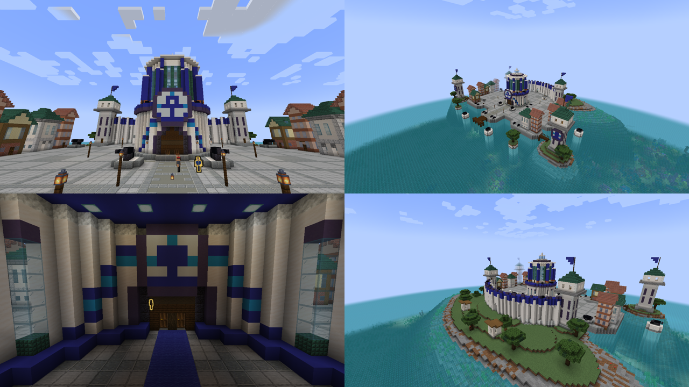

# Redbrick Port — blueprint (layout 16)

The Marines' naval fortress, built to the owner's specification. Three pieces are the owner-approved original
design (the headquarters crown, the entrance frieze and the crest); everything else follows the spec as written.
Code: `src/main/java/com/grandline/world/plan/RedbrickPort.java`. Worlds made before layout 16 keep the old
Redbrick Port (`FirstSeaPlans.RedbrickPortLegacy`) and its old chest spots.

Local coordinates from the headquarters' centre: +x east, +z south. The dock is south, the crescent wall north.
Plaza surface y 65 (walking height 66); sea 62.

| Piece | Where | Notes |
|---|---|---|
| Plaza | six chamfered platforms: core −30..30 × −38..26, apron −9..9 × 20..38, wings x ±27..±50, quays z 22..32 | smooth stone tiles on a polished andesite grid, darker tiles in a regular pattern, light grey avenue and ring round the HQ, stone brick quay walls; water pools between the platforms |
| Headquarters base | round, 21 across, y 66–76 | smooth quartz, calcite plinth and cornice, tall narrow cyan windows (dark prismarine sills, navy caps) |
| Entrance (south) | 5 wide × 7 high, pointed | dark oak double doors, blackstone frame, navy outer frame, lanterns on brackets |
| Frieze *(own design)* | front face | blue + light-blue rope-and-wave bands rising from the foot of the wall to the crest medallion |
| Crest medallion | 9 × 9 over the doors | navy ring, white field, blue anchor, light-blue compass star |
| Artillery platform | y 77–78, 23 across | blue concrete, navy rim, six cannons aimed outward |
| Crown *(own design)* | y 79–92, drum 15 across | eight blue buttress fins (andesite + orange terracotta feet), one tall lit clerestory of light-blue glass with dark prismarine mullions and sea-lantern rings, crown room inside (door on the north) |
| Roof | y 93–100 | shallow quartz roof, projecting rim, navy ring, glowing cupola, finial |
| Hall | inside the base | tiled floor, blue skirting, ceiling lights, crest over the doors, crest banners, carpeted aisle to a dais, ladder to the platform |
| Crescent wall | r 39–41, 215°–325°, y 66–79 | quartz on calcite, ribs both faces, barred slits, blue band, dark-blue walkway, navy merlons, four cannons, gate at the middle, crest banners |
| Watchtowers | NW (−36,−26), NE (31,−26), SW (−60,29), SE (55,29) (shaft corners) | 6 × 6 shafts, blue slits, grey ledge, 8 × 8 chamber, dark prismarine roofs, pennants; crest on the south towers; north towers open onto the wall walk |
| Tower islets | south-west and south-east | separate grassy islets, dark oak bridges from the quays |
| Waterfront | 12 buildings on the wings and quays | A red-roof townhouses, B white admin blocks with dark prismarine roofs, C brick/sandstone coastal houses with dormers |
| Coastal platforms | six, 5 across | four with cannons, two with trees |
| Guard posts | two inside the wall (flat roofs), two on the north green (spruce lean-tos) | |
| Artillery | apron, quays, beside the HQ, door plinths, wing corners, HQ platform, harbour platforms, wall gun bays | all one design (the owner's): spruce carriage with trapdoor wheels, five-block blackstone barrel, button fuse; aimed away from the HQ |
| Trees | north green, tower islets | broad dark oak shade trees with spruce flecks |
| Dock | x −2..2, z 39..46 | dark oak, side sections at the end |

Anchors: arrival (0, 66, 34); quest giver (4, 66, 19); fisherman on the dock; boat (7, 63, 42); camps on the north
green and the west wing; boss arena on the east wing.

Chests: legendary in the crown room, rare in the north-east tower chamber, commons on the south-west quay and the
north green.
