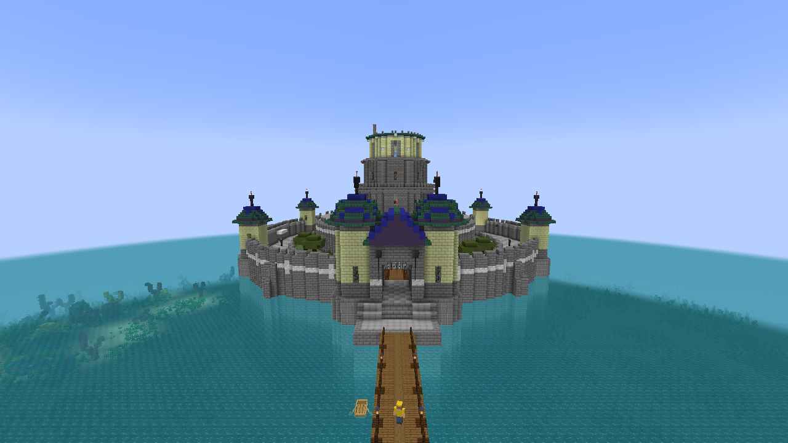
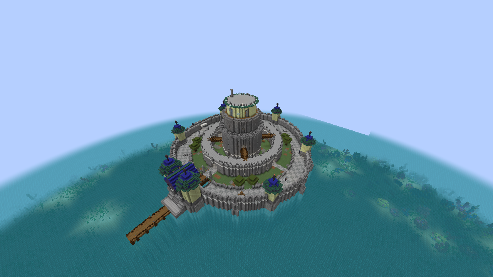

# Stonewall Prison (0.48.0, layout 15)

The round ocean fortress from the owner's specification. Lv 190-250. Code: `world/plan/StonewallPrison.java`.

## What is built (island-local, from the tower's centre; ground y 66)

- **Outer wall:**
  - about 88 across, slightly irregular, 2 thick, rising from the sea to y 71;
  - a walk on top, square battlements, a calcite band with white diamonds;
  - buttresses widening toward the sea; black banners on the inner face.
- **Five guard towers** in the wall:
  - 5 across, foundations in the sea, end stone bodies, three barred slits facing out;
  - a door and a ladder up to the wall walk;
  - a projecting dark prismarine rim, a layered blue dome (blue terracotta, blue concrete, dark prismarine stairs) and a
    small black flag.
- **Gatehouse (south):**
  - two big domed towers and the stone gatehouse with a pointed arch (5 wide, 7 high);
  - the raised iron portcullis with downward spikes, chains either side;
  - a sloped blue roof with dark spikes on the ridge;
  - a stone arrival platform with steps, and the pier (fisherman, boat).
- **Entrance bridge:** spruce and dark oak over a moat of sea water inside the gate, with iron and fence railings, the
  barred checkpoint at its inner end, and black banners.
- **Outer courtyard:**
  - a ring of square tiles (smooth stone and polished andesite) by the wall, with lanterns, barrels, debris and cages;
  - four grass courtyards inside it, with low curved walls, coarse dirt and tuff patches, and clusters of small angular
    trees (dark oak trunks, green concrete and terracotta crowns).
- **Inner enclosure (r 21-26):**
  - thick walls with a curved corridor inside: barred windows, lanterns, chains overhead, hanging cages, barrels,
    debris, ladders up;
  - four arched gates, a broad ledge on top with battlements, long black banners outside.
- **Central courtyard:**
  - grass with dark paths (tuff, stone, andesite, coarse dirt) from the tower's four arched entrances to the gates;
  - barrels, debris, lanterns, a ladder up the enclosure;
  - four wooden radial bridges from the ledge into the tower's third level, two on dark triangular supports.
- **Central tower** (24 across, top y 102):
  - the lower section: stone bricks, andesite pilasters, a white band, barred cell windows, wall lanterns, a projecting
    ledge with battlements;
  - the middle section, with small arched windows;
  - the upper section: end stone bricks, six tall blue arched windows with iron;
  - a flat round roof with battlements, a dark blue ring under its edge, sea lanterns and end rods.
- **Atrium** (inside the lower tower, open top to bottom):
  - four levels of cells round the wall, with arched barred fronts, small chambers, benches and chains;
  - curved galleries with low parapets, and curved spruce staircases between every level;
  - the stone bridge across the top level, and the great spruce beam with dark bands and downward spikes;
  - the spiral staircase down to the chamber.
- **Middle floor:** a guard room round the spiral up.
- **Upper furnished room:**
  - spruce floor, tall blue windows with iron, white banner curtains;
  - the gold chandelier (chains, gold arms, end rods, sea lanterns);
  - the fireplace (campfire behind iron bars) with its chimney through the roof;
  - bookshelves, a desk, the pale-bordered stair opening, a ladder to the roof.
- **Secondary chamber** (underground, r 20, y 47-65):
  - a tall curved wall with five narrow towers that have steep blue pointed roofs;
  - curved platforms with rails and ladders, chains strung between the towers, four hollow iron cages hanging from the
    ceiling;
  - a tuff and andesite floor, a dark railing, fragments, an anvil.
  - This is where quest bosses fight.
- **Waterfront landing (west):** small and stepped, a calcite doorway through the wall with steps up, a black flag,
  barrels, planks, debris and a spruce ramp into the water.

## Gameplay

- Arrival on the platform before the gate.
- Quest giver, innkeeper and Gravekeeper (Ghoul race) just inside the gate.
- Camps: the outer courtyard north (basic, Lv ~190-196 seen) and the central courtyard (stronger, Lv ~212-225 seen).
- Boss: the underground chamber.
- Treasure: legendary on the tower roof, rare on the enclosure ledge, commons in the east grass courtyard and on the
  waterfront landing.

## Notes and limits

- The specification's dimensions were kept: wall height, tower sizes, the 24-wide central tower and 3-4 high cell
  levels. The central tower is 35 tall (the spec gives 25-34) so that it has four cell levels, the middle floor and the
  furnished room.
- No custom models were needed:
  - spikes are lightning rods pointing down;
  - the portcullis is iron bars;
  - "rope" overhead in the corridors is chains.
- Worlds made with layouts 9-14 keep the 0.33.0 prison (`StonewallPrisonV9`, docs/STONEWALL_PRISON_V9.md); older
  worlds keep the original.
- **Fixed in this release (also for Crystal Fountain, 0.47.0):** the plan's ground is now declared as land in the
  terrain. Keeper NPCs and the island's gameplay area read the terrain, so without it the Gravekeeper here, and Crystal
  Fountain's innkeeper, could not find a spot.

## Checked

On a fresh world:
- The floating-block audit found 0 problems.
- All four chests are placed.
- The quest giver, innkeeper, fisherman and Gravekeeper are in place.
- Both camps fill.
- No water in the chamber or the atrium.
- Looked over in game: the harbour front, aerial, atrium, upper room, chamber and the enclosure corridor.

125 of 125 tests pass.
