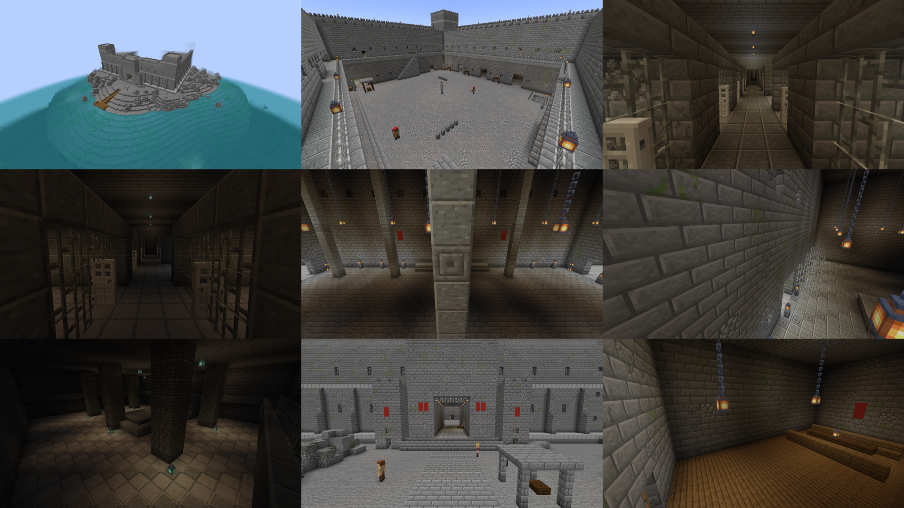

# Stonewall Prison, first rebuild (0.33.0; kept for layout 9-14 worlds, see STONEWALL_PRISON.md)

The prison island, Lv 190-250 (see FIRST_SEA_PROGRESSION.md). It is generated from code in `world/plan/StonewallPrisonV9.java`, with the same island id and position as before. Worlds created before this version keep the original prison (`StonewallPrisonLegacy`, layout 8). New worlds get the rebuild (layout 9).



The captures come from a fresh test world. The cell-block and Overseer shots were taken before the last lighting pass, which added chain lanterns there.

## Layout plan

Coordinates are island-local: +x is east and +z is south. The island ground is y 66 and the fortress floor is y 68.

```
                         north patrol yard (outside, stronger camp)
   +----+------------------------------------------------+----+
   | NW |  yard  |       WARDEN'S ARENA (north wing)    | yard | NE |
   | twr|        |  44 x 19, quest bosses               |      | twr|
   +----+--------+---------------------------------------+------+----+
   | HIGH-SEC     |                                       | COMMANDER'S |
   | cells        |            COURTYARD                  | chamber     |
   |--------------|         46 x 40, guards               |-------------|
   | CELL BLOCK A |   (Overseer's chamber below, y 56)    | CELL BLOCK B|
   +----+--------+---------------------------------------+------+----+
   | SW | yard   | office | records |gate| briefing | storage | yard | SE |
   +----+--------+-------------------+----+-------------------+------+----+
                                  gatehouse
                            forecourt (quest giver, innkeeper)
                                    pier
```

## Areas

| Area | Where | Contents |
|---|---|---|
| Island | about 140 x 135 | A grey stone crag with an irregular coast, boulder heaps of stone, andesite, cobble, tuff and mossy cobble along the shore, and sea stacks offshore. There is little vegetation. |
| Curtain walls | x -48..47, z -52..33 (96 x 86) | 3 thick and 22 high (floor y 68 to wall-walk y 90), on a plinth. The outside has buttresses every 8 blocks, two rows of barred slit windows and a string course. The top is a 3-wide wall-walk with battlements, an inner rail and lanterns. |
| Corner towers | 13 x 13, up to y 98 (30 high) | Walls two thick with barred slits. Inside, a stair climbs from a ground door (off the corner yard) to a landing at wall-walk height, with doorways onto both wall-walks. A second flight leads up through a hatch to the observation deck with battlements. |
| Gatehouse | south face, x -8..8 | A 7-wide passage under a raised iron-bar portcullis and a broad stair down to the forecourt. Two guard posts flank it, with red banners and a checkpoint desk. A crenellated platform on top joins the wall-walk. The passage runs through the south wing (lantern-lit, roofed by a bridge room) into the courtyard. |
| Courtyard | x -23..22, z -28..11 | Stone and gravel paving with a patrol ring, two roofed guard stations, weapon racks, barrels, stone cover and lamp posts. A gallery walkway runs round all four sides at the upper floor, reached by stairs on the west and east sides. This is the combat area (basic camp). |
| Cell Block A | west wing, south | A corridor with cells on both sides: iron bars, open iron doors, a bed, a bench and a light in each. There is a guard desk at the courtyard entrance. |
| High-security cells | west wing, north | Larger cells of polished andesite off their own corridor, behind a barred divider, lit by soul lanterns. They have their own courtyard entrance. |
| Cell Block B | east wing, south | A narrow corridor of small reinforced cells, with a barred checkpoint and a guard desk at the way in. |
| Commander's chamber | east wing, north | A tall hall with iron-bar partitions and a central platform. A balcony with banners runs along the outer wall, reached by a stair, and the upper floor has an overlook. You can enter from the courtyard and from Cell Block B. |
| Warden's arena | north wing | A 44 x 19 hall open to the roof, with pillars, a raised platform at the far end, high barred windows, banners, and chain and post lanterns. It has three entrances from the courtyard and doors from the two north corner yards. Quest bosses fight here. |
| Administration | south wing, west | The warden's office (desk, shelves, map table, banner) and the records room (bookshelves, lectern). Upstairs is the observation balcony, which opens onto the gallery with seats looking over the courtyard. |
| Guard block | south wing, east | The briefing room (benches round a table, banner) and the storage room (barrels and chests). |
| Overseer's chamber | under the courtyard, floor y 56 | A stair goes down from the courtyard's north-east corner behind iron bars. Below are massive deepslate pillars, a raised walkway round three walls (with a short stair) and a central platform, lit by soul and plain lanterns. |
| Upper floors | all wings | Lit patrol floors, entered from the gallery and joined across the gate by the bridge room. |
| Corner yards | four, between the towers and the wings | Paved yards with a lamp post and a barrel, opening into the towers and the neighbouring wing. |
| North patrol yard | outside the north wall | A gravel yard with a watch post, barrels and a low sea wall. This is the stronger camp. |
| Pier | south, z 55-80 | A spruce pier on stone footings with a wide head, cargo, and a roofed guard checkpoint at the landing. |

Atmosphere: weathered stone brick (cracked, mossy and cobble courses), polished andesite and smooth stone, iron bars everywhere, red banners at the gate and in the halls. Light comes from chain-hung and post lanterns, with soul lanterns in the secure blocks.

## Spots

- **Quest giver:** in the forecourt by the gate, at (7, 67, 47), facing the fortress.
- **Innkeeper:** in the forecourt at (-7, 67, 50).
- **Gravekeeper:** auto-placed near the main NPCs, as before. Stonewall is still the Ghoul unlock island.
- **Fisherman:** on the pier head.
- **Boat and arrival:** at the pier and the landing.
- **Camps:** the courtyard (basic) and the north patrol yard (stronger).
- **Quest bosses:** the Warden's arena.
- **Treasure:** on the east headland.

## Access

The game is played in adventure mode, so every way in is an opening or an open door: wooden doors and the cells' iron doors are placed open. The routes were checked in game by server-side block checks: the tower ground doors, landings and wall-walk doorways, the gallery stairs and all four gallery corners, the gate passage, the cell-block, high-security, Cell Block B and Commander entrances, the arena entrances, the corner-yard doors, and the Overseer stair and passage.

## Bosses

The current registry has one boss for this island: the quest boss, which fights in the Warden's arena. The Commander's chamber and the Overseer's chamber are built as full arenas, but no new bosses were added for them, per the brief. They are ready for bosses if they are registered later.

## Not as briefed

The Warden's arena is 44 x 19 rather than about 28 x 28. A 96 x 86 fortress with a 46 x 40 courtyard leaves the north wing only about 19 deep.
