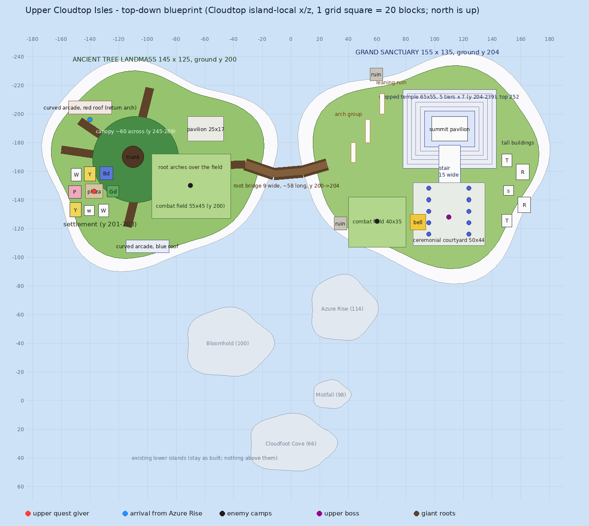
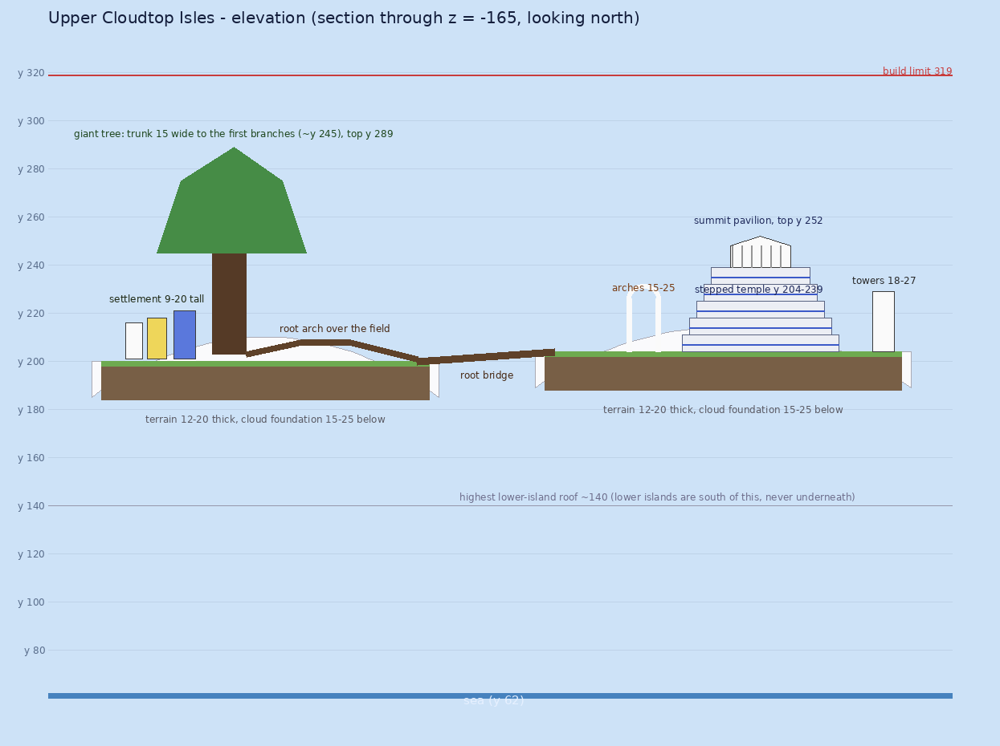

# Upper Cloudtop Isles: Phase 1 coordinate blueprint (for approval)

Status: **approved and built in 0.46.0** (see CLOUDTOP_ISLES.md). Changes from this plan during the build: the castle moved down to the lower region (the owner chose this); the arrival and return moved 5 blocks east with the red arcade; the landmass outlines are squarer with rounded corners so every piece fits inside.

## Placement

* Part of the existing Cloudtop Isles island (world centre -1500, -540); island-local coordinates below. The spec's own
  coordinates (Ancient Tree centre 0,0; Sanctuary 190,0) map to **Ancient Tree centre (-95, -165)** and **Sanctuary centre
  (95, -165)**: the same 190-block spacing, placed north of the lower islands.
* **No overlap with the lower islands**: both landmasses and their clouds lie north of z -97, and every lower island lies
  south of it, so nothing hangs over anything. The lowest cloud is about y 160; the highest lower roof is about y 140.
* Island reach grows from 190 to about 300 blocks. The nearest other island is more than 850 blocks away.
* A new world layout (13): worlds made with layout 12 keep the 0.45.0 sky islands as they are.
* Highest point: the tree top at y 289 (the build limit is 319).

## Ancient Tree landmass: 145 x 125, ground y 200 (gentle terraces 200-203)

| Feature | Local x, z | Size | Height (top y) |
|---|---|---|---|
| Landmass | x -167..-23, z -227..-103 | 145 x 125, irregular | terrain 12-20 thick; clouds 15-25 below (to ~y 160) |
| Ancient tree trunk | (-110, -170) | 15 across; mound y 203 | first branches ~y 245, top y 289; canopy ~60 across |
| Giant roots | 5 from the trunk: E (to the bridge, arching over the field), N, NW, W, S | 5-12 wide | walkable tops (dark oak stairs/slabs) |
| Settlement | around (-137, -146) | x -155..-121, z -163..-129 | 9-20 tall |
| White narrow buildings | corners (-153,-162), (-134,-137) | 7 x 9 | 15, 13 |
| Yellow multistory | (-144,-163), (-154,-138) | 8 x 10 | 17, 18 |
| Blue-domed tower | (-133,-163) | 9 x 9 | 20 |
| Green-domed tower | (-128,-150) | 8 x 8 | 16 |
| Pink house | (-155,-150) | 9 x 9 | 10 |
| Small white house | (-144,-136) | 7 x 7 | 9 |
| Plaza | x -143..-131, z -151..-141 | 12 x 10 | |
| Combat field | x -97..-43, z -172..-128 | 55 x 45 | the east root arches over it 6-8 high |
| Classical pavilion | x -72..-48, z -198..-182 | 25 x 17, plinth 2 | columns 9, total ~15 |
| Curved arcade, red roof | x -155..-126, z -209..-201 | 30 x 9 | 15 |
| Curved arcade, blue roof | x -115..-86, z -112..-104 | 30 x 9 | 13 |
| Root bridge departure | (-32, -165) | | y 200 |

## Root bridge

From (-32, -165, y 200) to (25, -165, y 204), curving gently north and back: about **58 blocks** of path, **9 wide**
walking surface (7 at the narrowest), bark side walls, no railings, rising 4 blocks over its length.

## Grand Sanctuary: 155 x 135, ground y 204

| Feature | Local x, z | Size | Height (top y) |
|---|---|---|---|
| Landmass | x 17..173, z -233..-97 | 155 x 135, irregular | as above |
| Stepped temple | x 78..142, z -217..-163 | base 65 x 55, five tiers of 7, each 3 in per side | y 204-239 |
| Upper platform | x 93..127, z -202..-178 | 35 x 25 | y 239 |
| Summit pavilion | x 98..122, z -198..-182 | 25 x 17, columns 9 | top y 252 (48 above ground) |
| Main staircase | x 103..117, from z -143 (y 204) to z -178 (y 239) | 15 wide, run 35 | rise 35 |
| Ceremonial courtyard | x 85..135, z -152..-108 | 50 x 44 | floor y 204 |
| Striped columns | x 96 and x 124, every 8 from z -148 to -116 | 2 rows of 5 | ~12 |
| Golden bell | frame x 83..93, z -130..-120 | bell 9 wide, 9 tall | frame ~15 (y 219) |
| Arch group | (52,-196), (42,-180) intact; (62,-214) leaning ruin | 10-18 wide, piers 2-4 thick | 15-25 |
| Tall buildings | (147,-172) T, (157,-165) R, (148,-150) s, (158,-142) R, (147,-130) T | 7x9 / 9x11 / 7x7 | 22, 25, 12, 20, 18 |
| Ruins | (55,-232), (30,-128) | 9 x 9 | 8-15 |
| Combat field | x 40..80, z -142..-107 | 40 x 35 | |
| Root bridge arrival | (25, -165) | | y 204 |

## Gameplay (existing systems only)

* **Arrival:** the existing sky arch on Azure Rise now carries players to the Ancient Tree landmass, in front of the
  red-roofed arcade at (-140, 201, -196). The **return** is a walk-through arch in that same arcade, so no extra
  structure is added.
* Upper quest giver: the settlement plaza (-137, 201, -146).
* Upper enemy camps: the Ancient Tree combat field (-70, -150) and the Sanctuary combat field (60, -125).
* Upper boss: the ceremonial courtyard (110, 204, -128).
* Respawn, quest navigation, notifications and rewards are unchanged (they already follow the upper-region anchors).
* Treasure chests: re-picked outdoors once built.

## Where the spec's proposed numbers had to move (please confirm)

1. **Staircase:** the spec gives a 25-block rise, but the upper platform is 35 above the ground. Proposed: a 35 rise
   over a 35 run, one block up per block, 15 wide.
2. **Golden bell:** the spec's spot (5, 20 from the sanctuary centre) is on the staircase's foot. Moved to the
   courtyard's west side, off the central approach.
3. **Tall building cluster:** the spec's spot (40, 20) overlaps the courtyard. Moved to the sanctuary's east side.
4. **Courtyard:** centred on the staircase so it really is the temple approach (the spec placed it 30 blocks west of it).
5. **Gap:** the landmass centres are 190 apart, so the edges are about 40 apart where the bridge crosses (the spec gives
   35). The bridge is about 58 long because it starts and ends on small peninsulas.

## Shadows

* Nothing in this layout hangs over another island.
* Since 0.45.1, floating islands, cloud platforms and bridges cast no shadow on islands, water or the sea floor
  (see LIGHTING.md).

## Block IDs

All IDs in the spec exist in 1.20.1, including `minecraft:grass`, `packed_mud`, `raw_gold_block`,
`light_weighted_pressure_plate`, `smooth_sandstone_slab`, `prismarine_stairs`/`_slab`,
`polished_andesite_stairs`/`_slab` and the pink, magenta and red banners.
